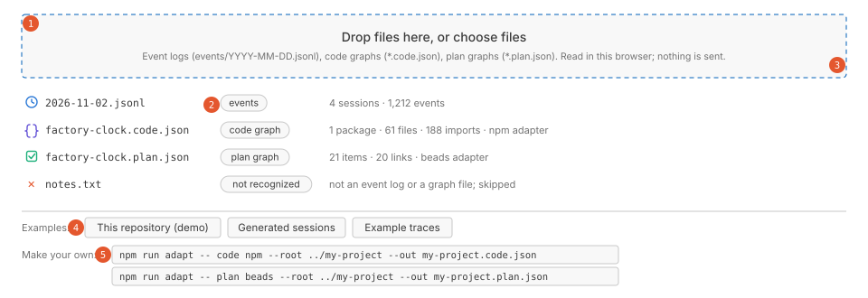
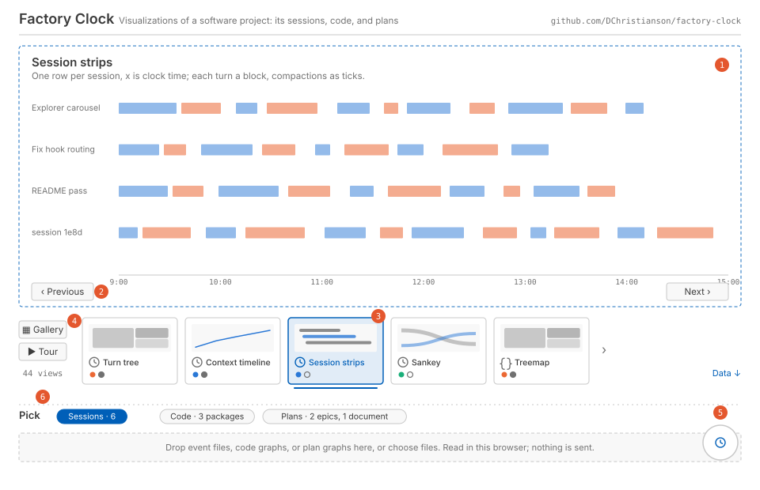
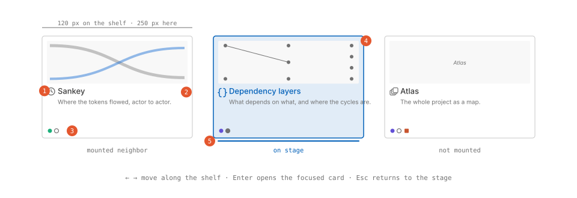
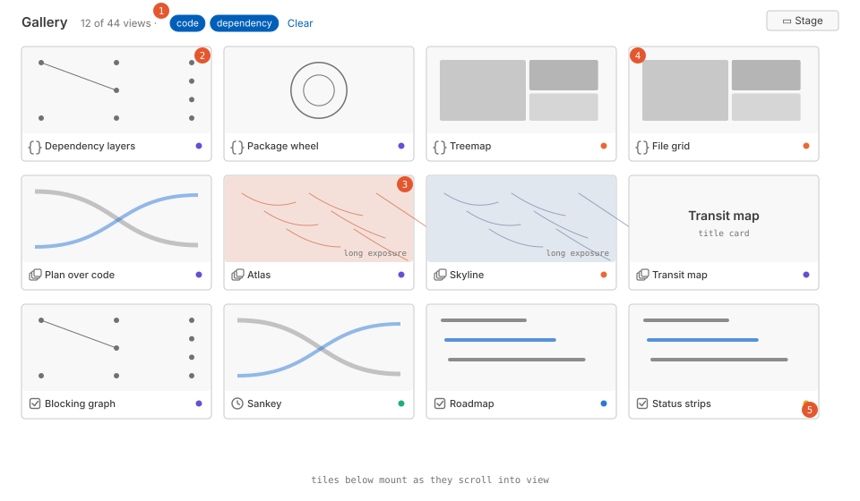
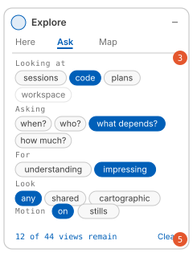
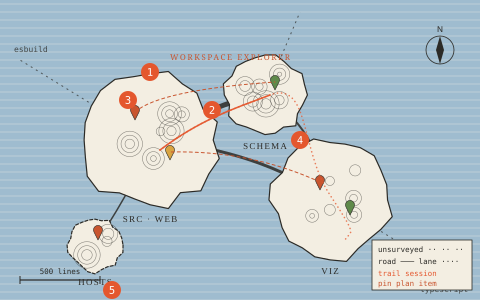
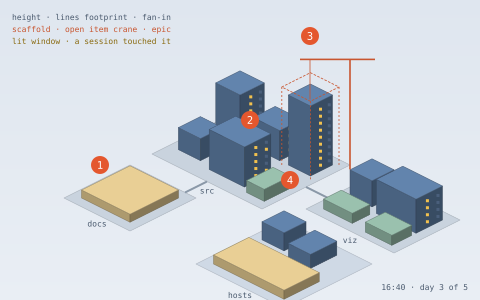
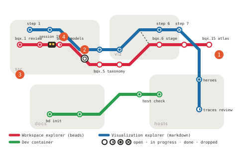
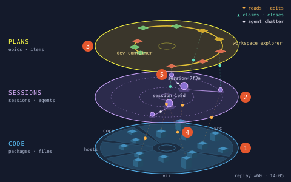

# Design: the workspace explorer

Status: **accepted** (2026-11-13, in review with the owner, with the changes in [Decisions](#decisions): adapters run in the page, the five existing hero views stay hero views, and every view credits its prior art). Proposed 2026-11-12; sketches, the owner's Strata view, and the fusion question added 2026-11-13. Design-language fusion is not decided: a spike decides it. It extends the [visualization explorer](visualization-explorer.md), which stays the design of record for the session views and the visualizer contract; nothing there is undone by this document, and **every existing view and every existing design language stays**. The [preliminary plan](#preliminary-plan) at the end is tracked in beads under the epic named there.

Sketches of every screen and state are in [`images/`](images/): one static SVG per frame (`sketch-*.svg`, linked from the sections below) drawn from [`images/workspace-explorer-sketches.html`](images/workspace-explorer-sketches.html), the sketch page itself, which also plays the Strata artboard's motion. The sketches are wireframes in the page's own neutrals and accent; the hero artboards are color.

## Summary

Factory Clock draws coding-agent sessions 32 ways. This design makes it a showcase of visualizations over the whole of a software project: its **sessions** (what the agents did), its **code** (the artifacts and what depends on what), and its **plans** (the work intended, and what blocks what). One page, one explorer, one catalog, one contract.

Three things change.

1. **Subjects.** The explorer gains two subjects beside sessions, *code* and *plans*, each with a shared schema that an **adapter** fills from a particular tool: a build system for code (npm workspaces and TypeScript imports first), an issue tracker or a planning document for plans (beads and planning markdown first). Adapters run **in the page**: you pick a project's folder, and the page reads its files and builds the schema in the browser, sending nothing, the way it reads event files today. A fourth subject, *workspace*, is all three loaded together with the joins between them, and is what the new hero views draw.
2. **The explorer.** The carousel becomes a **stage** with a **shelf**: one view fills the stage, and a strip of cards under it names every view the current filters allow, so fifty views are a scroll rather than fifty presses of Next. A **gallery** mode spreads the shelf into a grid of live thumbnails. The **puck** stays, and becomes a **guide**: it still names the view you're on and filters by tags, and it also asks what you want to see (which subject, which questions, informative or expressive, which look, motion or not), keeps the answers, and recommends an order. A **tour** plays through the recommended views for a showcase.
3. **Hero views that show everything at once.** The five hero views stay hero views, and four join them, each a whole-project picture in a new design language: the **Atlas** (cartographic: code is terrain, dependencies are roads, plan items are pins and routes, sessions are trails), the **Skyline** (isometric: packages are blocks, files are buildings, open work is scaffolding, sessions are the lights coming on), the **Transit map** (plans as lines and stations over the code districts they run through, sessions as trains), and the owner's **Strata** (code, sessions, and plans as three stacked planes with the messages between them moving). A **Loom** may follow.
4. **Credit.** Every view names the prior art it draws on, in its catalog entry, shown in the puck and on a credits list.

## Problems this addresses

1. **Sessions alone can't say what the work was about.** A session view shows that an agent read, edited, and ran things; which part of the project, and in service of which plan item, is invisible. The questions people ask next ("what did this week's sessions touch", "which planned work is blocked on what", "where in the code is the churn") need the code and the plan in the same page.
2. **The carousel doesn't scale.** It was designed for five views and holds 32; with two more subjects it would hold sixty. Linear travel with dots stops being a way to find a view, and the puck's facet chips, which were the remedy, don't say which view to pick, only which views remain.
3. **Preferences are implicit.** A visitor who wants to be impressed and a visitor who wants to diagnose a slow build are served the same order. The puck knows the vocabulary (purpose, language) to tell them apart and never asks.
4. **There's no view of everything.** The five hero views are each a session or a set of sessions. A showcase wants one picture a person can point at and say "that's the project": its shape, its intent, and its activity.

## Goals

- One contract still: a visualizer is one plain script that draws what it's given. The 32 session views run unchanged, with one new tag each, and the five design languages they carry stay in the vocabulary as they are. Nothing is retired by this design.
- Two new shared schemas, code and plan, small enough that an adapter is an afternoon's work and a view can be written against the schema alone.
- Adapters for the tools this project itself uses, so the demo is this repository: its npm package and TypeScript imports, its beads, and its design documents as planning markdown.
- An explorer that lets a visitor find a view by what they want, not by position, and that can run itself as a showcase.
- Three hero views of the whole project, each with its own design language, under the same rules as the first five (no dependencies, SVG and DOM, system fonts, both themes where the language follows the theme).
- The same promises: a static page, files read in the browser, no network requests, text through `textContent`.

## Non-goals

- A server, an index, or any fetch. Everything runs in the page, adapters included, and all data stays in the browser.
- Semantic analysis of code or plans: no parsing beyond imports and build manifests, no embeddings, no model calls. Planning markdown is read by heuristics that say they're heuristics.
- Editing. The page shows plans; it doesn't change them.
- Every build system. The adapter layer is designed for many; this plan builds one for code and two for plans, and the rest come with the projects that need them.
- Replacing Snagboat's own pages. Snagboat keeps its two session views; it may later load the explorer, as the old design foresaw, but nothing here depends on it.

## Subjects and schemas

A **subject** is a kind of thing the explorer can show. Each has a model type in `src/model/`, a validator (so a dropped file is checked before a view sees it), a synthetic generator for the page's examples and the unit tests, and a picker that lists its top-level units.

The picker lists each loaded subject's units under a tab of its own ([sketch](images/sketch-picker.svg)).

| Subject | Model | Unit the picker lists | Source today |
| --- | --- | --- | --- |
| `sessions` | `SessionView[]` (unchanged) | A session | Snagboat's daily event files |
| `code` | `CodeGraph` | A package or build target | A code adapter's JSON |
| `plans` | `PlanGraph` | An epic, milestone, or document | A plan adapter's JSON |
| `workspace` | `Workspace` = the three above plus joins | — (draws whatever is loaded) | Built in the page from the others |

### CodeGraph

Artifacts in a hierarchy, with typed dependencies between them.

```ts
interface CodeGraph {
  kind: 'code-graph'; version: 1;
  source: { adapter: string; root: string; generatedAt: string; tool?: string };   // root is a name, never an absolute path
  artifacts: Artifact[];
  dependencies: Dependency[];
}
interface Artifact {
  id: string;                       // stable within the file: the path for files, the manifest name for packages
  kind: 'workspace' | 'package' | 'target' | 'module' | 'file' | 'external';
  name: string;
  path?: string;                    // relative to the root; files and modules have one
  parent?: string;                  // containment: file in module in package in workspace
  language?: string;                // 'ts', 'js', 'css', 'md', 'json', 'sh', ...
  size?: { bytes?: number; lines?: number };
  role?: 'source' | 'test' | 'doc' | 'config' | 'asset' | 'generated';
  metrics?: Record<string, number>; // an adapter's extras (fan-in, fan-out, churn); views that use one name it
}
interface Dependency {
  from: string; to: string;
  kind: 'import' | 'build' | 'test' | 'runtime' | 'dev' | 'link' | 'reference';
  weight?: number;                  // import count, or 1
  inferred?: boolean;               // true when found by a heuristic rather than read from a manifest or resolved by the tool
}
```

An `external` artifact is a dependency outside the root (an npm package, a system library) and has no path. The join to plans and sessions is by `path`.

### PlanGraph

Items of work with status, in a hierarchy, with typed links between them. Every item says whether it was read or guessed.

```ts
interface PlanGraph {
  kind: 'plan-graph'; version: 1;
  source: { adapter: string; root: string; generatedAt: string; tool?: string };
  items: PlanItem[];
  links: PlanLink[];
}
interface PlanItem {
  id: string;
  kind: 'epic' | 'milestone' | 'feature' | 'task' | 'bug' | 'step' | 'decision' | 'question' | 'note';
  title: string;
  status: 'open' | 'in_progress' | 'blocked' | 'done' | 'deferred' | 'dropped';
  priority?: number;                // 0 is highest, as beads counts
  parent?: string;
  created?: string; updated?: string; closed?: string;   // ISO timestamps where the source has them
  assignee?: string;
  labels?: string[];
  refs?: { paths?: string[]; artifacts?: string[]; sessions?: string[]; urls?: string[] };
  confidence: 'observed' | 'inferred';
  text?: string;                    // description; present only when the adapter was told to keep text
}
interface PlanLink {
  from: string; to: string;
  kind: 'blocks' | 'parent' | 'relates' | 'supersedes' | 'discovered-from' | 'follows';
  inferred?: boolean;
}
```

`follows` is the order of a numbered list of steps: step 3 follows step 2. It's weaker than `blocks` and drawn differently, since a document's order isn't always a dependency.

### Workspace and joins

`Workspace` holds whichever of the three are loaded and the joins the page can make:

| Join | Key | Status |
| --- | --- | --- |
| Plan item → code artifact | `refs.paths` matched to `Artifact.path` (a path, or a directory prefix) | Buildable now: markdown links and beads descriptions name paths |
| Plan item → session | A session's prompt text naming the item's id (`factory-clock-1av`) or title; text capture must be on | Heuristic, inferred |
| Session → code artifact | The paths a session's tool calls touched | **Built at load** (decided 2026-11-13): a `touches` list per session from the loaded events' file targets, relative to the workspace root, never command lines or absolute paths. Present only when the loaded files carry targets: the owner's own event files do, the redacted demo traces don't, and views say so. `SessionView` itself still carries no targets |

Each join is a list of `{ from, to, inferred }` and views draw inferred joins as inferred (dashed, hatched, or ≈), the rule the first design set.

## Adapters

An adapter is a TypeScript module that reads one tool's artifacts and returns one schema object. It runs **in the page**, inside the bundle, so a project's code and plans are read the way event files are: in the browser, from files the visitor chooses, sending nothing (decided 2026-11-13). The same module also runs in Node, for the unit tests and for the build that makes the demo.

**How a project reaches the adapters.** The loader gains a **Choose a project folder** button (`<input type="file" webkitdirectory>`, which current browsers support and the page's security policy allows, since it's a file the visitor chose and not a fetch), and a folder can be dropped too. The page walks the chosen files, skips `.git`, `node_modules`, build output, and binaries, stops at named limits (2 MB per file, 20,000 files, both tuned on the first target project), and hands each adapter a list of `{ path, text }` with paths relative to the folder. An adapter never sees an absolute path, the disk, or the network.

**Detection.** Each adapter says whether the files are its kind: a `package.json` turns on the npm adapter, a beads export the beads adapter, Markdown with plan-shaped sections the markdown adapter. The loader lists what each one found ("npm: 1 package, 61 files; beads: 24 items; markdown: 3 documents, 64 items") with a switch to turn one off.

```ts
interface ProjectFile { path: string; text: string; bytes: number }    // path relative to the chosen folder
interface AdapterOptions { name: string; keepText?: boolean; hints?: string[] }
interface Adapter<T> {
  id: string;                      // 'npm', 'beads', 'markdown'
  subject: 'code' | 'plans';
  detect(files: ProjectFile[]): boolean;
  read(files: ProjectFile[], options: AdapterOptions): T;   // a CodeGraph or a PlanGraph
}
```

Adapters live in `src/adapters/<subject>/<tool>.ts` and import only the model types: no Node builtins and no DOM, so the build's rule that no Node import reaches the bundle covers them, and the tests run them in Node unchanged. Each ships with a fixture (a tiny project under `src/test/fixtures/adapters/<tool>/`) and a unit test that checks the output validates and matches a snapshot. Adding an adapter is a file, a fixture, a test, a line in the adapter list, and a row in the table below.

Options are switches in the loader: the project's name (what `source.root` says; the folder's name by default), **keep text** for plan adapters (off by default, so descriptions are kept only when asked), and hints, below. A schema file (`*.code.json`, `*.plan.json`) can still be dropped, for the demo's files and for projects read elsewhere, and is validated the same way.

### Code adapters

| Tool | What it reads | Artifacts | Dependencies | When |
| --- | --- | --- | --- | --- |
| **npm + TypeScript/JavaScript** | `package.json` (and workspaces), the source tree, `import`/`export … from`/`require` lines | workspace, packages, files; `external` for packages in `dependencies`/`devDependencies` | `import` between files (resolved by relative path and index files, `inferred` when the resolution guessed), `runtime`/`dev` from the manifest | First: this repository is one |
| Cargo | `Cargo.toml`, `use`/`mod` | packages, modules, files | `import`, `build` | With a target project |
| Go modules | `go.mod`, `import` blocks | module, packages, files | `import` | With a target project |
| Maven / Gradle | `pom.xml` / `build.gradle`, `import` | modules, packages, files | `build`, `import` | With a target project |
| Python | `pyproject.toml`, `import`/`from` | package, modules, files | `import` | With a target project |
| Bazel / Buck | `BUILD` files | targets | `build` with `deps` | With a target project |

The first adapter reads imports with a line scanner, not a parser: `import … from 'x'`, `export … from 'x'`, `require('x')`, and `/// <reference path>` lines. It resolves relative specifiers against the tree (`./a` → `a.ts`, `a.js`, `a/index.ts`) and marks a dependency `inferred` when it had to guess; a bare specifier becomes an `external`. Factory Clock's own `viz/*.js` scripts import nothing and talk through globals, so the adapter also records a `reference` dependency from each file to the files named in its comments' `see` lines and from `hosts/web/index.html` to the scripts it loads, both `inferred`, so the page's real structure shows. That's a Factory Clock-specific rule and lives in a `globals` hint, a switch the loader offers, not in the adapter's core.

Every file gets `size.lines` and a `role` from its path (`test` under `src/test/`, `doc` for `.md`, `config` for manifests and dotfiles). Fan-in and fan-out are computed in the page from the dependencies, not by the adapter, so every adapter gets them for free.

### Plan adapters

| Tool | What it reads | Items | Links | Confidence |
| --- | --- | --- | --- | --- |
| **beads** | `bd export` (JSONL, one issue per line) or `.beads/issues.jsonl` | One per issue; `issue_type` → kind, `status` and `priority` as given, timestamps as given, `parent` from the parent-child dependency | `blocks` and `parent` from the dependency list, `discovered-from` and `relates` where present | `observed` |
| **planning markdown** | `*.md` under a folder: design documents, roadmaps, plans, READMEs with a Steps or Plan section | Headings become epics or milestones (by depth); numbered lists under a heading named Steps, Plan, Phases, or Roadmap become `step`s; `- [ ]` and `- [x]` become tasks; rows of a table with a Status, State, or Done column become items; a Decisions table's rows become `decision`s, an Open questions list's items `question`s | `parent` from nesting; `follows` from list order; `blocks` from phrases in the item's text ("after X", "depends on X", "blocked by X", "waits for X", "once X is in", "needs X") when X matches another item's title or number; `supersedes` from "replaces X" | `inferred`, except a checkbox's status, which is `observed` |

The markdown adapter is a heuristic and the schema makes that visible: every item it produces says `inferred` unless a checkbox said otherwise, and a view that shows status shows how sure the source was. The heuristics to start with are the ones that read [visualization-explorer.md](visualization-explorer.md) correctly: its **Steps** list with "done" in bold, its tables with a Status-like column, its Decisions and Open questions sections, and phrases like "after step 5" and "waits for". That document, with this one, is the markdown fixture, so the heuristics are tested on the plans this project actually writes. Status words that set an item done: `done`, `built`, `shipped`, `accepted`, `closed`, `✓`; in progress: `in progress`, `started`, `partly`, `but for`; deferred: `later`, `deferred`, `not planned`, `waits`. Each word's effect is a row in one table in the adapter, so adding a project's own vocabulary is a row.

Beads keeps its issues in a Dolt database that a browser can't open, so the beads adapter reads beads' JSONL export: `.beads/issues.jsonl` in the chosen folder when the project keeps one, or a file made with `bd export` and dropped beside the folder. The loader says which it used, and how to make one when it found neither. The export's fields, which this project has seen: `id`, `title`, `description`, `status`, `priority`, `issue_type`, `created_at`, `updated_at`, `closed_at`, the dependency list, labels, and comments. Comments are counted, not kept. Keep text keeps descriptions.

### What the page does with a file



The sketch predates the decision to run adapters in the page: its *Make your own* commands become a **Choose a project folder** button beside the drop zone, and its file list gains a row per adapter that detected something.

The loader stops being three things and becomes one: choose a project folder, or drop or choose any files, and the page sorts them out. A folder goes to the adapters, as above. Single files are sorted by content. A `.jsonl` whose first line has `kind` and `ts` is events; a `.json` whose top is `kind: 'code-graph'` or `'plan-graph'` is that subject; anything else is named and refused. Several files of one subject merge (two plan files are one plan with two sources; two code files are two roots). Each subject's data and picks live in the page state the way sessions' do now, and the explorer is remounted over the new `Workspace`.

For the examples, the page builds without any file: the synthetic sessions it has, plus a synthetic code graph (a fake monorepo of five packages and some 120 files with imports, a couple of cycles, and tests) and a synthetic plan (three epics, thirty items, blocks and parents, dates spread over a month), both seeded. Beside them, as the demo traces are today, the demo **workspace**: this repository's own code, beads, and planning markdown, read at build time by `scripts/site.js` running the same adapters in Node and written into the page, and offered with the traces. Everything it reads is already in this public repository except the beads export, which is committed after the owner has read it. Later, static data from a target project goes in the same folder the same way.

## The explorer

The explorer is still one script, `explore.js`, mounted over a source object, and still sees only `ctx` and the source. The source grows per subject: `listUnits(subject)`, `loadUnits(subject, ids)`, `onWorkspace(cb)`; the session methods stay as aliases so the page's session code doesn't change in the same step.

### Stage and shelf, not a carousel



The carousel's three parts, strip, dots, and buttons, become:

- **The stage.** One view, full width, the height the window leaves (at least 320px), with the slide header as today (title, description). Previous, Next, and the arrow keys still move to the neighbor on the shelf, so nothing anyone learned is lost. Only the stage's view and its two shelf neighbors are mounted, as the carousel mounts three slides; neighbors are mounted but hidden, so the next press is instant. With a **compare** toggle the stage splits in two, each half a view, the shared selection linking them; it's the cheapest form of the "aligned layers" the first design kept putting off, and it's how a session view and a code view sit side by side.
- **The shelf.** A horizontal strip of cards under the stage, one card per view the filters allow, in the catalog's order within the subject order chosen by the guide. A card is the view's title, its subject glyph, and a row of facet dots; the current card is marked, and the strip scrolls to keep it in view. Click a card to put it on the stage. The dots and the "7 of 32" count are gone; the shelf is both.
- **The gallery.** A button turns the shelf into a grid that takes the stage's place: every allowed view as a live thumbnail at card size, drawn once with `ctx.fitter` on the same data, replay stopped (`setActive(false)`), tooltips off, click to open on the stage. Thumbnails mount as they scroll into view and unmount as they leave, so a gallery of sixty costs what the viewport holds. A view that can't draw small says so in its catalog entry (`thumbnail: 'title'`) and gets a title card. This is the showcase's overview and the first thing a visitor should see.
- **The tour.** Play on the shelf advances through the allowed views every N seconds (default 20, the puck's choice), hero views getting their replay's length instead; the puck narrates each ("why this view", below). Pausing stops it; any click ends it. With `prefers-reduced-motion` the tour doesn't start on its own.

The frames, in order: [shelf card anatomy](images/sketch-cards.svg), [the gallery](images/sketch-gallery.svg), [compare](images/sketch-compare.svg), and [the tour](images/sketch-tour.svg).





Alternatives considered:

| Alternative | For | Against | Verdict |
| --- | --- | --- | --- |
| Keep the carousel, add subject tabs | Smallest change | Three carousels of twenty; the dots problem three times | No |
| A gallery only (grid of thumbnails, click to enlarge) | The obvious showcase | Loses the linear "next" that makes comparison a keypress; a grid of sixty live views is expensive and busy | As a mode, not the shell |
| A map of the catalog (views placed by facets, click to open) | Fits a visualization project; shows the taxonomy's shape | Hard to read for a first visit; a facet grid has empty cells and crowded ones | In the puck, as its third body (below) |
| Stage and shelf | Keeps linear travel, scales to sixty, thumbnails where they help | Two things to look at (stage, shelf); the shelf needs a glyph per subject and a tiny facet language | **Chosen** |
| A scripted tour only | The purest showcase | Nobody can explore | As a mode |

### The puck as a guide

The puck keeps its shape (a corner panel, collapsible to a circle, draggable to any corner, above the tooltip layer) and gets three bodies, chosen by a small tab row at its head. Sketches: [collapsed](images/sketch-puck-collapsed.svg), [Here](images/sketch-puck-here.svg), [Ask](images/sketch-puck-ask.svg), [Map](images/sketch-puck-map.svg).



1. **Here.** What's on the stage: title, description, tags as chips (as today, every facet value shown, picked ones lit), and two new lines. *Why this view*: one sentence the catalog entry carries (`why`), written for a visitor, such as "Which packages depend on which, and where the cycles are". *Next*: the next card on the shelf, with its why, so the shelf reads as a path.
2. **Ask.** The preferences, as questions with chip answers, saved in the page state:
   - *Looking at*: sessions, code, plans, the whole workspace (one or more). Loaded subjects are offered; the rest are dimmed and say "load a file".
   - *Asking*: the seven category questions, in their words ("When did things happen?", "What depends on what?"); pick any.
   - *For*: understanding (informative) or impressing (expressive); both is the default.
   - *Look*: any, the shared look (`standard`), or one or more of the design languages, each with its one-line description.
   - *Motion*: on, or stills only (sets replay to its final frame, as reduced motion does).
   - *Tour pace*: seconds per view.

   Answers are filters: subject, category, purpose, and language map onto the facets directly, and the shelf shows what remains. The facet chips in *Here* stay as the precise instrument, and the two never disagree because they're one state. A *Clear* resets everything. The first visit opens *Ask* once, collapsed to its first two questions, so a visitor is asked before they're shown; after that the puck starts collapsed as today.
3. **Map.** The catalog drawn: a dot per view on a small grid of subject (rows) by category (columns), colored by language, lit when the filters allow it, the stage's view ringed; hover names it, click opens it. It's a visualization of the visualizations, which a showcase should have, and it shows at a glance which cells are empty (where the catalog has gaps), the use the first design wanted from the taxonomy.

The guide's recommendation is the shelf's order: within the allowed views, subjects in the order picked, then the catalog's order, which already runs from the plain views to the heroes. No scoring model; the order is explainable and the catalog's order is editorial. If scoring is wanted later, it's a function over tags and preferences in `src/explorerModel.ts`, testable in Node.

### Taxonomy changes

**In short:** the taxonomy is the set of tags every view carries and the puck filters by. Today it can say *what question* a view answers and *what it looks like*, but not *what it's a picture of*, because everything was a picture of sessions. The change adds that, as a new tag `subject` (sessions, code, plans, or the whole workspace), plus a few words the new views need. Nothing existing is renamed or removed; the 32 views just gain `subject: sessions`.

One new facet and a few values, all additive. Every entry gives every facet, as before, and the unit test keeps it so.

| Facet | Change |
| --- | --- |
| `subject` (new) | `sessions`, `code`, `plans`, `workspace`. A view lists the subjects it draws; a view that draws a *Shape* (below) lists several. Every existing entry gets `sessions`. |
| `level` | Adds `unit`: one picked unit of code or plans (a package, an epic), stacked one per unit as `session` views stack per session. `session` and `project` are unchanged; `project` means the whole loaded set for every subject. |
| `category` | Unchanged. `dependency` and `state` finally have the views the first design said they were waiting for. |
| `dimension` | Adds `structure` (containment: package, module, file; epic, task), `status` (open, blocked, done), and `place` (where in the code). |
| `language` | Adds `cartographic`, `isometric`, `transit`, and later `textile`, one per hero view, with that view. |

The catalog entry gains `why` (the guide's sentence), `thumbnail` (`'live'`, the default, or `'title'`), `hero` (below), and `credits` (below).

### Shapes: one view, several subjects

**In short:** a treemap of a session's tokens and a treemap of a project's files are the same picture with different data. Rather than writing a second treemap for code and a third for plans, the existing one learns to draw a neutral form, a *Shape* (boxes inside boxes, plus lines between them), and each subject knows how to turn itself into one. Five existing views get this, so code and plans start with ten views almost for free, and those views keep drawing sessions exactly as they do now.

Five of the existing views draw a hierarchy, a graph, or both, and don't care that the nodes are turns and agents: the treemap, the sunburst, the adjacency matrix, the Sankey, and the actor graph. Rather than three copies each, the kit gains a **Shape**, the one form all three subjects can take:

```ts
interface Shape {
  nodes: Array<{ id: string; label: string; parent?: string; value: number; kind: string; colorGroup: number; status?: string; inferred?: boolean }>;
  links: Array<{ from: string; to: string; weight: number; kind: string; inferred?: boolean }>;
  valueLabel: string;      // 'tokens', 'lines', 'items'
  kinds: string[];         // the legend, in color order
}
```

Each subject's model offers `shapeOf(data, options)`: sessions by tokens (the turn tree's tree with the actor graph's edges), code by lines (containment, with dependencies as links, `by: 'file' | 'module' | 'package'` to fold), plans by count (parents, with `blocks` as links). A view that draws a Shape is tagged with every subject and gets, with the `update` call, `options.shape` already built for the loaded subject on the stage; it keeps drawing `SessionView[]` when given no shape, so nothing changes for the session-only path. Porting the five is five small changes, and it gives code and plans ten real views on day one of the standard set.

## Views for the new subjects

The standard set, each a file under `viz/`, a catalog entry, and a note in this document when built. Ordered by how much each adds beyond the Shape views.

**Code**

| View | Question | category | purpose | dimension |
| --- | --- | --- | --- | --- |
| Dependency layers | What depends on what, in what order, and where are the cycles? Files or modules placed in layers by longest path from the leaves; a cycle's members share a layer and a warning ring; edges bundled per layer pair | dependency | informative | dependency, structure |
| Package wheel | Which packages talk to which? A chord diagram over packages, inner arcs by module, ribbons by import count, externals on their own arc | dependency, quantitative | expressive, informative | dependency, quantity |
| File grid | How big and how connected is everything? Files as cells in package rows, laid along a Hilbert curve so a package's files stay together and the grid holds still when files are added (prior art #4), sized by lines, colored by fan-in, tests and docs in their own hues | quantitative | informative | quantity, structure, place |
| Coupling matrix | (the ported adjacency matrix with cluster ordering) | dependency, actor | informative | dependency |
| Treemap, sunburst, Sankey, graph | (the ported Shape views) | quantitative, dependency | both | structure, quantity, dependency |

**Plans**

| View | Question | category | purpose | dimension |
| --- | --- | --- | --- | --- |
| Blocking graph | What's blocked on what, and what unblocks the most? A DAG, left to right by dependency depth, the critical path lit, inferred links dashed | dependency, state | informative | dependency, status |
| Roadmap | When was each item opened and closed, under which epic? A Gantt by epic over created→closed (open items run to today), status by hue, the markdown steps' `follows` order as a chain | temporal, state | informative | time, status, structure |
| Status strips | Where does the work stand? A strip per epic, items as blocks in status order, the done fraction as the strip's fill (the session strips' idea over plans) | state, quantitative | expressive, informative | status, quantity |
| Burn-up | How fast is work closing against how fast it's opened? Cumulative created and closed over time, scope as the gap | quantitative, temporal | informative | quantity, time |
| Confidence map | How much of this plan was read and how much guessed? Items by source document and confidence, so a markdown plan shows its seams | state | informative | status |
| Treemap, sunburst, graph | (the ported Shape views) | quantitative, dependency | both | structure, dependency |

**Workspace** (needs two or more subjects loaded; draws what's there)

| View | Question | category | purpose | dimension |
| --- | --- | --- | --- | --- |
| Plan over code | Which parts of the code does each plan item name? The file grid with plan items as pins on the files they reference, status by hue, unreferenced items in a margin | dependency, state | informative | place, status, structure |
| Touch map | Which files did the sessions touch, how often? The file grid heated by session activity (waits for the session→code join) | quantitative, temporal | expressive, informative | place, quantity, actor |

## Hero views: everything at once

### All nine are hero views

The five hero views built for sessions, Living Network, Session Fingerprint, Conversation Landscape, Terminal Board, and Factory Clock, **stay hero views** (the owner, 2026-11-13). The four below join them; none replaces one. To make that a fact the explorer can use rather than a convention, the catalog entry gains `hero: true`, set on all nine:

- The shelf puts heroes last, as the carousel does now, and the gallery has a **Heroes** chip that shows just the nine.
- The tour ends on the heroes, and in the puck's *Ask*, answering *For: impressing* leads with them.
- The Map rings hero dots.
- The first five keep `subject: sessions`. With a workspace loaded they still draw its sessions; teaching them about code or plans (files as nodes in the Living Network, say) is possible later and not planned.

`hero` isn't a facet, because it's a role rather than a question a view answers, and filtering on it from *Here*'s chips would duplicate `purpose: expressive` in most cases. It's one boolean, tested to be set on exactly the views this document and the first one list.

### Four new ones

The first five hero views are each one question with a look chosen for it. These are each the *whole project* with a look chosen for it: a picture a person points at. Each takes the `workspace` subject and draws whichever parts are loaded, saying in its note which parts are missing, as Conversation Landscape says why it has no words. Each has a replay, from the shared clock, when sessions are loaded: time runs over the sessions' span, and the plan's items change state at their timestamps.

The candidates, with the metaphor each uses for the three subjects and the join each needs:

| Candidate | language | Code | Dependencies | Plans | Sessions | Needs | Verdict |
| --- | --- | --- | --- | --- | --- | --- | --- |
| **Atlas** | `cartographic` | Terrain: packages are landmasses, modules regions, files the contours' height (lines) | Roads, bundled, width by weight; externals as sea lanes to the margin | Pins by status on the files they name; an epic a region label; `blocks` as dashed routes between pins | Trails across the map as the replay runs; a hero's wake | Plan→code join (now); session→code join (for trails) | **First** |
| **Skyline** | `isometric` | A city: packages are blocks, files are buildings, height by lines, footprint by fan-in | Streets by fan-out; a bridge where packages import each other | Scaffolding and cranes on the buildings open items name; a done item's scaffolding comes down in replay | Windows lighting up as sessions touch files; night falls as a day ends | The same two joins; works without sessions as a daylight city | **Second** |
| **Transit map** | `transit` | Districts shaded under the lines: the packages the lines run through | Not drawn, except as district adjacency | Lines are epics (or documents), stations are items, interchanges are items two epics share or `blocks` across lines; a station's ring is its status | Trains: a session is a train that stops at the stations it mentions, moving in replay | Plan→session join (heuristic) | **Third** |
| **Loom** | `textile` | Warp threads, one per file or module, grouped by package | A float where a thread's imports cross | Weft bands: a plan item's span in time, colored by status, over the threads it names | Weft rows: each session a pass of the shuttle, over the threads it touched; the cloth grows in replay | Session→code join, or it's a plain plan-over-code weave | Fourth, once the join exists |
| Storylines | (narrative) | Lanes, one per package, stacked | — | Items as events on the lanes they name | Each actor a line through time that bends into the lane of the file it touches, lines converging when actors share a file (prior art #20) | Session→code join | A sibling of the Loom with time horizontal; choose one of the two when the join exists |
| **Strata** | `strata` | The floor: a wheel of packages, files as blocks inside them | Not drawn on the floor; the wheel's order is depth from the entry point | The roof: each epic a ring, items around it by dependency order, hue by status | The middle plane: sessions on an inner ring, agents on an outer orbit; messages travel between the planes | Session→code join for the downward messages; works without it | **Fourth** (the owner's addition, 2026-11-13) |
| Planisphere | (dark) | Stars by size, constellations by package | Constellation lines | Named nebulae over the stars they touch | Meteors | Both joins | Not now: too close to Living Network's look |
| Blueprint | (drawing) | A floor plan: nested rooms | Wiring and ducts | Redline annotations | The draftsman's marks | Both joins | Not now: the Atlas with a different sheet; revisit if the Atlas disappoints |
| Orrery | (brass) | — | — | Milestones as planets, items as moons, blocks as orbital resonance | — | None | Not now: plans only, and the Transit map says more |

### Atlas

A map of the project drawn as a map: terrain, roads, pins, and trails.



- **Why this view:** so that "where in the project" has a place to point at. Every other view answers a question; this one gives the project a geography the other views' answers can be found on.
- **Visual model:** code is land. Packages are placed by the shared force layout over their dependencies (so packages that import each other are neighbors), then each is an island whose coast comes from circle-packing its modules and files (the enclosure diagram); elevation contours inside an island follow file size, so a big file is a hill. Dependencies between islands are roads (a bundled curve, width by weight) and across the margin, to externals, dotted sea lanes. Plan items are pins on the files or modules they reference, hue by status, with epics as region labels set in small caps along the islands they touch; `blocks` links are dashed routes between pins. Sessions are trails: in replay, each actor's path across the files it touched is drawn as a line that fades, so a day's work shows as wake over the map.
- **Design language:** `cartographic`. An uncoated paper ground, hachures and contour lines in a single ink, water in a flat second ink, place names in small-caps serif with letterspacing, a scale bar and a compass rose that mean something (the scale bar is lines of code; the rose is the layout's orientation, fixed by hashing so the map is the same each visit). Inferred things are drawn as a cartographer draws uncertain coasts: a dashed line, and "unsurveyed" in the legend (the HPI software maps use sketchiness for the same purpose, prior art #10).
- **Prior art:** Kuhn's Software Cartography (prior art #1) is the ancestor: a stable map of a codebase that thematic overlays reuse. Its known pitfall is that people read closeness as dependency when the placement was by vocabulary. The Atlas places by dependency, so closeness *is* dependency, and the note says so.
- **Palette and type:** paper `#f3eee2`, ink `#2b2a26`, water `#9fbccf`, terracotta `#c8552f` for open work, moss `#5f8a4a` for done, ochre `#d9a441` for in progress, slate `#6b7280` for deferred. A serif stack with small caps (Georgia and the system serifs; font files stay out, as for the first heroes).
- **Encoding:** position is layout by dependency, enclosure is containment, contour count is size, road width is import weight, pin hue is status, trail opacity is recency.
- **Interactions:** hover a file for its name, size, fan-in, fan-out; hover a pin for the item; click selects the artifact or item (the shared selection gains `artifactId` and `itemId`); zoom to an island; toggle roads, pins, trails; replay controls.
- **Guardrails:** islands never overlap (the layout separates by radius); roads are aggregated per package pair past a limit; pins cluster into a numbered marker past a limit per island; trails are capped and the oldest fade first; with no sessions there are no trails and the note says so; with no plan there are no pins; inferred joins are dashed.
- **Limits** (named constants): islands before folding the smallest into "other", 24; files per island drawn individually before folding to modules, 200; roads before aggregation, 300; pins per island before clustering, 12; trails in flight, 48.

### Skyline

The project as a city, seen from a fixed isometric angle, with the work under way as scaffolding and the sessions as lights.



- **Visual model:** packages are city blocks on a grid placed by dependency (the same force layout, snapped to a grid); files are buildings with footprint by fan-in and height by lines, so a widely imported file is broad and a long one is tall; tests are low glass buildings, docs are pavilions. Streets between blocks carry the imports between packages. An open plan item puts scaffolding on the buildings it names (a crane for an epic); a done item's scaffolding is gone, and in replay it comes down at the item's close time. With sessions loaded, replay runs through a day: windows light in the buildings a session touches and go dark as it moves on, and the sky darkens as the day ends.
- **Design language:** `isometric`. A fixed 2:1 projection in SVG, flat faces in three tones of one hue per role, hard shadows one way, no gradients but the sky. It should look like an architectural model, not a game.
- **Prior art:** CodeCity (prior art #9) for the metaphor and its treemap placement; ScrumCity (#11), the one earlier picture that tied a code city to planned work, in 3D and never on the web; the isometric contribution skylines (#13) for how cheaply a pure-SVG city draws.
- **Guardrails:** a block folds its files to modules past a limit; the tallest building sets the scale and the note says the height is lines; scaffolding is drawn on the building, never floating; lights are capped like particles.

### Transit map

The plan as a metro map, laid over the districts of the code it runs through.



- **Visual model:** each epic (or, for markdown, each document) is a line in its own color; items are stations in order of dependency depth, then creation; an item under two epics or linked by `blocks` across lines is an interchange; a station's ring is its status (hollow open, half in progress, filled done, crossed dropped). Lines are routed octilinearly (horizontal, vertical, diagonal) by a simple heuristic, not an optimizer, and the result is stable by hashing. The districts under the lines are the packages the line's items reference, shaded faintly and named. With sessions, a session is a train: it stops at the items it mentions, in replay, and sits in a depot otherwise.
- **Design language:** `transit`. A white ground, thick colored lines with rounded joins, stations as rings, sans-serif station names set horizontally or at 45°, a legend in the corner, the honest clutter of a real network diagram.
- **Guardrails:** a line with more than a limit of stations folds its done stations into a count at the start; interchange detection is by explicit links only; the note says which epics are lines and that distances mean nothing.
- **Prior art:** metro maps of project plans go back to Stott and Rodgers (prior art #18), and a zero-dependency SVG metro-map builder exists to learn octilinear routing from; the districts underneath, and the trains, are what's new.

### Strata

The three subjects as three planes of one object, with the messages between them as the only thing that moves. The owner's design, added 2026-11-13 from the sketch page's frame 12.



- **Why this view:** the other three heroes put everything on one surface and ask the eye to tell the subjects apart by mark. Strata separates them by height and makes the joins between them the picture: what a session did to the code is a message dropping, what it did to the plan is a message rising.
- **Visual model:** three discs seen at a tilt, stacked. The **floor** is code as a wheel: packages are wedges sized by file count, files are low blocks inside them with height by lines, inner ring to outer by depth from the entry point. The **middle** plane is sessions and their agents: a session sits on an inner ring at the angle of the wedge it works in most, its subagents on an outer orbit, joined by spawn lines. The **roof** is the plan: each epic a ring, its items placed around it in dependency order, hue by status; bigger epics take outer rings. In replay, messages travel between the planes: reads and edits drop to the files they touch, claims, comments, and closes rise to the items they name, and session-to-agent traffic stays on the middle plane. A faint shaft stays where each message passed, so the rest state is the long exposure of a day's traffic.
- **Design language:** `strata`. A deep void, one hue per plane (steel blue for code, violet for sessions, amber for plans), each plane a translucent disc with a thin bright rim, blocks and items as flat-shaded solids, messages as small bright dots with a halo, amber going down and teal going up. Labels in a monospace at the left edge, one per plane.
- **Palette:** void `#141a2b`; code `#3a7ca5`, sessions `#8a6fd1`, plans `#d4a72c`; down `#ffb347`, up `#5fe0c0`, lateral `#f4f1ff`; item status done `#6fbf73`, in progress `#d4a72c`, open `#e36b4f`.
- **Encoding:** plane is subject, angle is package (shared by all three planes, so a session over a wedge and an item over a wedge are about the same code), ring is depth or epic, height is lines, message direction is what kind of act it was, shaft density is how much traffic a pair has seen.
- **Interactions:** drag tilts the stack (a fixed-axis tilt, a parameter of the same projection the Skyline uses, not a 3D camera); hovering a plane lifts it apart from the others to read alone; click a block, a session, or an item to select it; replay controls.
- **Guardrails:** the three planes share one angular layout, computed once from the code wheel, so nothing moves between replays; files fold to modules past a limit per wedge and items fold past a limit per ring; messages in flight are capped like the Living Network's particles; with no sessions the middle plane is empty and the note says so; without the session→code join only the upward messages draw, and the note says so.
- **Limits** (named constants, to tune): wedges before folding, 12; blocks per wedge, 40; items per ring, 24; messages in flight, 48.
- **Prior art:** none found that stacks these three; the nearest are the layered software-map overlays of Software Cartography (prior art #1), which reuse one layout under several themes, and ScrumCity's (#11) linking of a code city to sprints.

### What applies to all

The same rules as the [first five](visualization-explorer.md#what-applies-to-all-five): one file under `viz/`, a catalog entry with its language, markup from `ctx` and styles in `viz.css` under a view-scoped class, system fonts, every mark leads back to a selection, performance tried on the largest real workspace available (this repository is small; a target project with a few thousand files is the test). Each hero view sets `hero: true`, carries its `credits`, and takes part in the tour. Its thumbnail is its **long exposure**: the view's rest state after a full replay (every trail drawn, every light that ever came on left faintly on), drawn once at card size with the replay stopped, the way a print of a Gource run would look. The first five hero views already have a rest state (the field after Conversation Landscape's replay finishes), so the same rule gives them thumbnails too; a view whose rest state is unreadable small still has `thumbnail: 'title'`.

## Design languages: keeping all, fusing some

**In short:** each hero view has its own look: the Terminal Board is a station's flip-board, the Living Network a dark field with glowing particles. Today a look belongs to one view. *Fusing* would let you mix them: show the Living Network but with its labels on flip-board tiles that clack over when something changes, or draw the Terminal Board in the enamel and ink of the Factory Clock dial. To allow that, each look is split into four parts that can be swapped separately: the background and colors, the lettering, the shapes, and the way things move. The puck would offer "Living Network *with* Terminal Board's lettering". **This isn't decided:** step 22 tries it on two looks first, to see whether it's cheap and whether the mixes look good, and step 23 happens only if it is.

Every language built so far stays, as a value in the vocabulary and as the look of the view that carries it. The question the owner raised on 2026-11-13 is whether languages can also be **fused**: Terminal Board's split-flap text on the Living Network's dark field, say, or the Terminal Board drawn as an enamel dial. Today they can't, because a language is a property of a view, baked into its script and its scoped block in `viz.css`. This section proposes how they could be, as a later step whose worth a spike decides first.

### What a language is made of

Reading the five languages built and the four proposed, each divides into four parts that don't depend on each other:

| Slot | What it holds | In `cinematic` | In `split-flap` | In `horology` |
| --- | --- | --- | --- | --- |
| **Sheet** | The ground, the ink roles on it, the palette for actor and status classes, and the texture (fog, grain, halftone). The one unit that contrast checks are run on. | Dark field, fog, grain; amber, cyan, violet, magenta | Near-black board, matte cells | Enamel dial, hairline track; ink, cobalt, gray, orange |
| **Type** | The faces and the way text is set: a label's case, spacing, and whether it sits in cells. | Grotesk labels, mono for ids | Fixed character cells, uppercase | Serif numerals, mono labels |
| **Marks** | How a node, a link, a region, and a change of state are drawn. | Blooming node, curved link, comet particle | A region is a block of cells; a change is a flap turning | A ring is depth, an arc is a span, hatching is waiting |
| **Motion** | How change arrives, and what the rest state looks like. | Particles in flight, drift while playing | Falling flaps with a minimum dwell | A sweep hand; arcs fill behind it |

A view today uses all four from one language. A fusion is a view using the slots of two or three. "Living Network, split-flap type" keeps the cinematic sheet, marks, and motion, and sets its labels in flap cells that turn when a node's state changes. "Terminal Board, horology sheet" keeps the board's cells and flaps and draws them in ink on enamel. Not every combination means something: the Terminal Board's marks *are* its type (a region is cells), so "Terminal Board with cinematic marks" is just the Living Network. Fusions are named "A with B's C", and the shelf card shows two language swatches.

### How it would be built

- **Sheets are indivisible.** The ground, the ink roles, the palette, and the texture are one slot, because the contrast checks are run on them together; a fusion never takes the ground from one language and the ink from another. That keeps every fusion within the checks already run, and the number of real combinations small: sheet × type × marks × motion, with most cells empty because a view doesn't use every slot.
- **Slots in `viz.css` and the kit.** Each language's CSS moves from a view-scoped block to four attribute-scoped blocks, `[data-sheet="cinematic"]`, `[data-type="split-flap"]`, and so on, with the sheet's colors as variables the mark and type blocks read. The non-CSS parts (the fog and grain filters, the flap animation, the particle cap, the force drift) become kit helpers that take the sheet's variables rather than their own constants. A view sets the four attributes on its host from `options.look` and otherwise draws as it does now.
- **A view declares its slots.** The catalog entry's `language` tag keeps listing the base languages, and a new `slots` field says which of the four the view reads and which it allows to be swapped (`type` and `sheet` for most; `marks` only for views built on the Shape). The explorer offers only the swaps a view allows, so nothing is drawn with a slot it can't honor.
- **The puck's Look question** gains a second row: a base language, then "with …" chips per swappable slot, each naming a language that provides that slot. The chosen fusion is part of the preferences and travels with the tour. With nothing picked, every view draws exactly as it does today.
- **The new heroes are built against the slots from the start** (Atlas, Skyline, Transit, Strata), so they don't need the refactor the first five do.

### What decides it

A spike before any of this (plan step 22): factor `split-flap` and `cinematic` into the four slots, draw the two fusions named above, and record how much of each view's code had to change and whether the contrast checks still hold. If a fusion needs more than the attributes and the shared helpers, the slots are wrong or the idea is; if it's cheap, step 23 builds it. Until then, the only thing this section changes is that every new hero view keeps its sheet, type, marks, and motion in separate blocks, which costs nothing and leaves the door open.

## Credits

Every view acknowledges the prior art it draws on: the chart type it is, the technique or layout it uses, and the metaphor it borrows (the owner, 2026-11-13). Credits are for others' work only; this project, its owner, and its own design documents are never credited (the owner, 2026-11-13).

```ts
interface Credit {
  work: string;              // 'Hierarchical Edge Bundles'
  by: string;                // 'Danny Holten'
  year?: number;             // 2006
  url?: string;              // only a link someone has opened and checked
  relation: 'form' | 'technique' | 'metaphor';
  note?: string;             // one line: what was taken
}
```

- **`form`** is the chart type itself (Sankey's diagram, the treemap). **`technique`** is a layout or algorithm used (edge bundling, circle packing, a Hilbert-curve order). **`metaphor`** is a borrowed picture (CodeCity's city, the metro map).
- **In the catalog.** `credits: Credit[]` on every entry; a unit test fails an entry with none, and one that credits this project. A view that looks original still has prior art: find the nearest form or technique it builds on (a strip per session is LifeLines; an event graph is Lamport's space-time diagram).
- **On screen.** The puck's *Here* gains an *After* line ("After Holten 2006 · Wettel & Lanza 2008"), each name linking to its source. Below the fold, beside the picker and loader, a **Credits** list is built from the catalog, one row per view with all its credits, so the page's whole debt is in one place. The README links to it.
- **For the new views**, credits come from [the prior-art survey](workspace-explorer-prior-art.md) as each view is built, and the rule joins those in [What applies to all](#what-applies-to-all).
- **For the 32 existing views**, credits are researched once (plan step 24) and every URL opened before it's recorded. To start from, with the details to check: treemap (Shneiderman, early 1990s), Sankey diagram (Sankey, 1898), streamgraph (Byron and Wattenberg, 2008), parallel coordinates (Inselberg, 1985), sunburst (Stasko and Zhang, 2000), Gantt chart (Gantt, 1910s), sequence diagram (UML).

## Testing

- **Schemas.** Validators for `CodeGraph` and `PlanGraph` with unit tests over good and bad files.
- **Synthetic data.** Seeded generators for both, in `src/web/`, with the same properties the session generator has: the same output every run, and shapes that exercise the views (cycles, an external-heavy package, a blocked chain, an epic with everything done).
- **Adapters.** The same modules the page runs, run in Node over a fixture project per adapter under `src/test/fixtures/adapters/`, the output snapshotted; the markdown adapter's fixture is this project's own `docs/`, so a change to the heuristics shows as a diff in what they read from the plans here.
- **Explorer model.** The guide's filtering and ordering, the loader's sorting of files, the joins, and `shapeOf` for each subject, in Node.
- **Views.** By hand, in both themes, on the synthetic workspace, the demo workspace, and, as they arrive, the owner's static target projects.
- **The page.** The build fails if a Node import reaches the bundle, as today, which now covers the adapters. The folder picker and the file walk are checked by hand on this repository and a target project.
- **Catalog.** Every entry has credits, and `hero` is set on exactly the nine hero views.

## Preliminary plan

Tracked in beads: the epic `factory-clock-bqx`, **Workspace explorer**, with one issue per step, `factory-clock-bqx.1` through `.24`, numbered as below and blocked in this order; `bd ready` lists what's unblocked. Steps marked ∥ can run beside the one before.

1. **Design review.** This document reviewed; the decisions below confirmed or changed, the open questions settled.
2. **Models.** `src/model/code.ts`, `plan.ts`, `workspace.ts` with validators, the joins (session→code from a `touches` list built at load), `shapeOf`, and unit tests. No UI.
3. **Synthetic workspace.** The two generators and their tests; the page's examples gain the code graph and the plan.
4. **Loader.** The project-folder picker and file walk, files sorted by content, adapters detected and switchable, subjects in page state, `Workspace` built and handed to a source with the new methods. ∥ with 3.
5. **Taxonomy and catalog.** The `subject` facet and the new values; `why` on every entry; `hero` on the five existing hero views; every existing entry tagged `sessions`; tests updated. Small and first among the UI changes, since everything after reads it. ∥ with 2.
6. **Stage and shelf.** The carousel replaced; previous, next, keys, and the three-mounted rule kept; the compare toggle; the picker per subject. Checked by hand that every session view behaves as before.
7. **The guide.** The puck's three bodies; preferences saved; the shelf ordered by them; the first-visit *Ask*.
8. **Code adapter: npm and TypeScript.** An in-page module with its fixture and test. ∥ with 5–7.
9. **Plan adapter: beads.** An in-page module over beads' JSONL export, with its fixture. ∥ with 8.
10. **Plan adapter: planning markdown.** The heuristics, tested on this project's docs.
11. **Demo workspace.** The build runs the adapters over this repository and writes the result into the page; the beads export is committed after the owner reads it; the page offers the workspace beside the traces.
12. **Shape views.** The five ported views draw code and plans. One change each.
13. **Standard views for code and plans.** Dependency layers, blocking graph, roadmap, status strips, package wheel, burn-up, file grid, confidence map, plan over code: one change each, in roughly that order, each a gap filled in the Map.
14. **Gallery and tour.** Thumbnails, mount-on-scroll, the tour and its narration. ∥ with 12–13.
15. **Atlas.** Its language in the taxonomy, the view, and its note here.
16. **Skyline.** Same.
17. **Transit map.** Same. ∥ with 16.
18. **Docs.** README, CONTRIBUTING (adding an adapter; credits for a new view), the visualizer contract (`options.shape`, the new selection fields), PRIVACY (a project folder is read in the browser like event files, and nothing is sent), and this document's implementation notes.
19. **Target project data.** The owner's static data for one or two projects, with whatever adapter they need, and the hero views tried at that size. Not scheduled; it starts when the data is chosen.
20. **Loom or Storylines.** One of the two, on the session→code join from step 2.
21. **Strata.** The fourth hero view, after Atlas's foundations (steps 11 and 12); its language in the taxonomy, the view, and its note here.
22. **Design-language fusion spike.** Factor `split-flap` and `cinematic` into sheet, type, marks, and motion; draw the two named fusions; record the cost. Decides step 23.
23. **Language slots.** The slots in `viz.css` and the kit, `slots` in the catalog, the puck's "with …" row. Every existing language unchanged when nothing is picked. Only if step 22 says so.
24. **Credits.** The `credits` field and its test, the puck's *After* line, the Credits list, and prior-art credits for all existing views, each source checked. ∥ with 6–7, after 5.

Steps 2–5 are the foundation and are small. Steps 6–7 are the visible change and the ones to look at early. Steps 8–11 make the demo real. Everything from 12 on is a view at a time, as before.

## Decisions

Confirmed in review with the owner on 2026-11-13. Rows marked *changed* differ from the proposal.

| Question | Proposal |
| --- | --- |
| Where adapters run | *Changed:* in the page, over a project folder the visitor picks; all data stays in the browser. The same modules run in Node only for tests and the demo build |
| The schemas | Two small ones, code and plan, with containment, typed links, and `inferred` on everything a heuristic produced |
| How a project reaches the page | One loader: a project folder goes to the adapters; single files (events, schema files, a beads export) are sorted by content |
| The explorer's shape | Stage and shelf, with a gallery mode and a tour; the carousel's keys and three-mounted rule kept |
| The puck | Stays; three bodies: Here, Ask, Map; preferences are the filters with a friendlier front |
| Recommendation | Catalog order within preference order, no scoring; scoring later if wanted, in the model |
| Taxonomy | One new facet, `subject`; `unit` level; three dimensions; one language per hero view |
| Reuse across subjects | A Shape in the kit, five views ported to draw it; everything else subject-specific |
| First adapters | npm + TypeScript (code); beads and planning markdown (plans); this repository as the demo |
| Markdown heuristics | A table of patterns in one file, tested on this project's own design documents; every result `inferred` |
| Hero views | *Changed:* the five existing hero views stay hero views, marked `hero: true` with the four new ones. New ones in order: Atlas, Skyline, Transit map, Strata; Loom or Storylines later |
| Session→code join | A `touches` list per session built at load from the events' file targets, relative paths only; absent for the redacted demo traces |
| A markdown plan's unit | By shape: a document with a Steps, Plan, or Phases section is one epic; otherwise each top-level heading is one |
| Tour on arrival | Only on the bare demo (nothing loaded, no preference saved), never with reduced motion |
| Credits | *Added:* every view credits its prior art in the catalog (`credits`), shown in the puck and a Credits list; a test requires them |
| Existing views and languages | All kept, unchanged; the design adds and never retires (the owner, 2026-11-13) |
| Fusing design languages | **Not decided.** The spike (step 22) shows two fusions working before anything is built. New heroes keep their four slots in separate blocks meanwhile, which costs nothing |
| Fonts | System stacks, as before |

## Open questions

- **Cycles in the npm adapter's imports.** This repository has none, and the first target project may; the dependency layers view needs to know how a cycle is reported (members on one layer is the proposal).
- **Thumbnails of hero views.** The long-exposure rule above is the proposal; whether a hero view's rest state reads at card size is known only once it's drawn. A pre-rendered image per view (a headless browser in the build) is the fallback and costs a dependency the build doesn't have.
- **The second subject tab in the picker.** The picker now lists sessions; with three subjects it's three lists. Whether they're tabs in the picker or three pickers stacked under the shelf is a layout call to make in step 6, with the data in front.
- **Large folders.** The file walk's limits are guesses until a target project with a few thousand files is tried; reading a big folder may want a progress line and a worker.

## References

- [Design: visualization explorer](visualization-explorer.md), the contract, taxonomy, and hero views this extends.
- [The visualizer contract](visualizer-contract.md), which gains `options.shape` and two selection fields.
- [Prior art: whole-project pictures](workspace-explorer-prior-art.md), gathered for this proposal; the numbers above (#1, #4, …) are its entries. Its closing finding is the case for the hero views: code maps, plan tools, and agent-activity tools each own one axis, and only ScrumCity joined two; no found work draws all three in one picture.
- [Design: visualization explorer](visualization-explorer.md#what-comes-next) on separating observed from inferred and leading expressive views back to the events, which every view here keeps.
